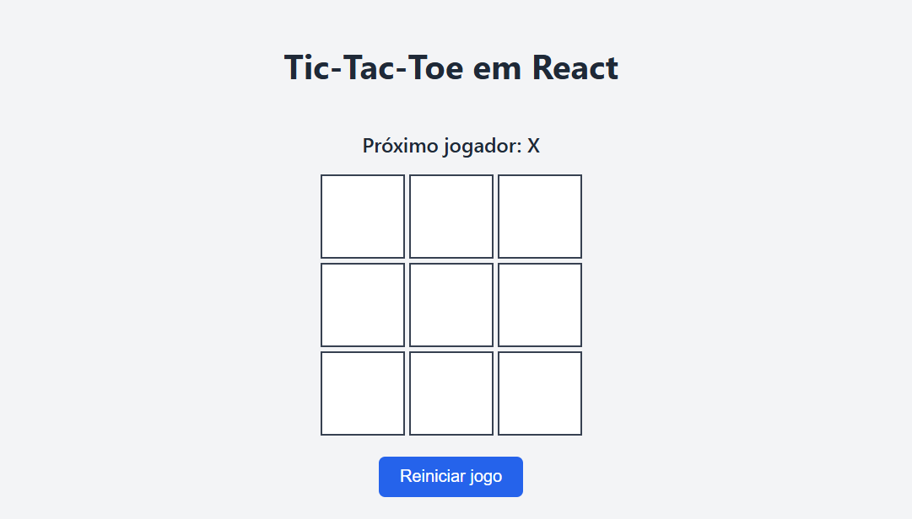
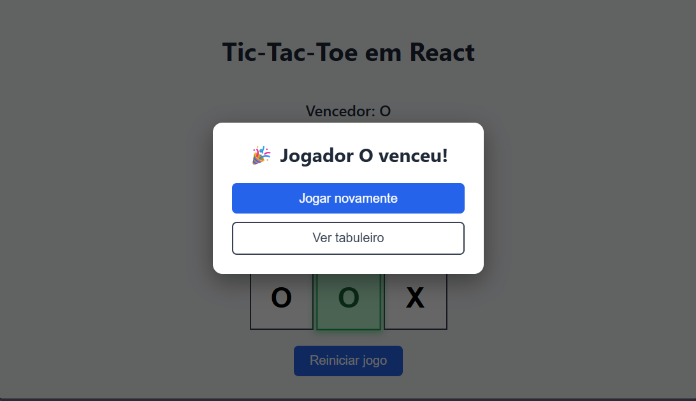
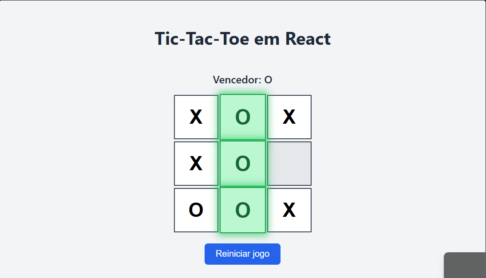
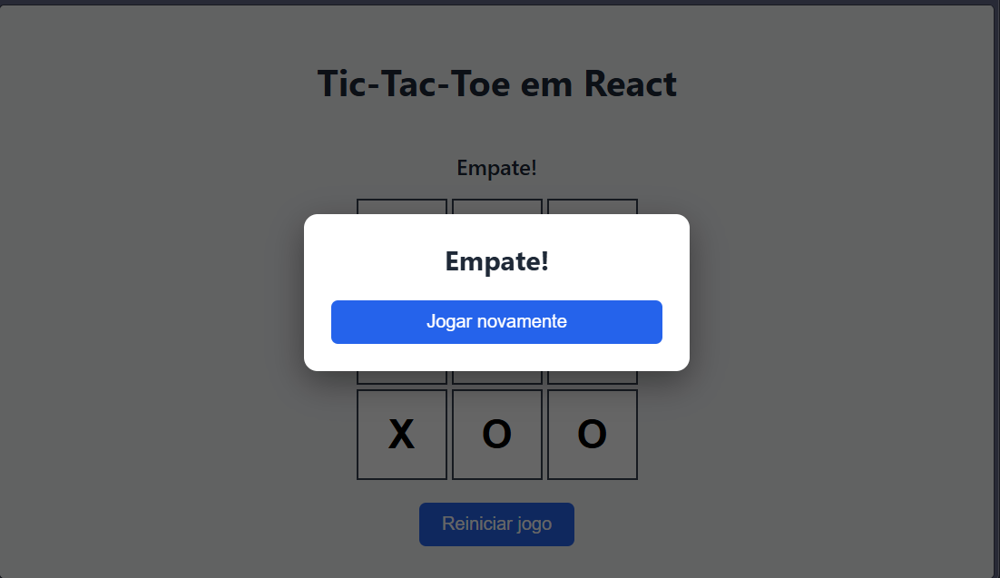
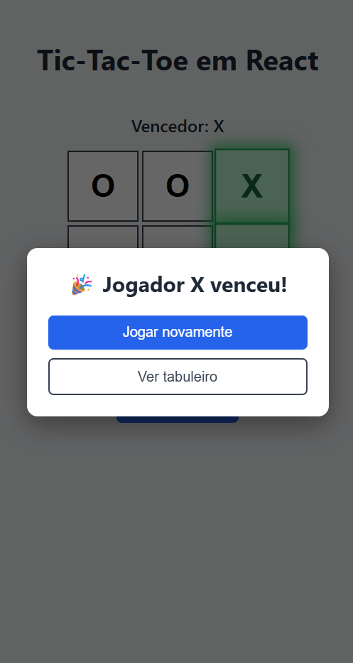

# Tic-Tac-Toe em React

## Descrição
Jogo da velha (Tic-Tac-Toe) feito em React para a disciplina de Coding (AV2 – Revisão 1).
Dois jogadores (X e O) alternam jogadas num tabuleiro 3x3. O jogo identifica vitória e empate, ilumina as casas da sequência vencedora, mostra uma tela de vencedor e pode ser reiniciado.

## Tecnologias
- React 18
- JavaScript (ES6+)
- Create React App (react-scripts)
- Jest + React Testing Library (testes automatizados)
- Git e GitHub

## Como executar
Requisitos: Node.js 18+ e npm.

```bash
git clone https://github.com/Pyndio/tic-tac-toe-project.git
cd tic-tac-toe-project
npm install
npm start
```
O jogo abre em http://localhost:3000. Testes automatizados: `npm test`.

## Como jogar
1. X começa; o painel mostra quem é o próximo jogador.
2. Clique numa casa vazia para jogar. Casas ocupadas não podem ser sobrescritas.
3. Vence quem completar uma linha, coluna ou diagonal. Se as 9 casas forem preenchidas sem vencedor, é empate.
4. Após o fim da partida não há novas jogadas. Use **Reiniciar jogo** para recomeçar.
5. Quando alguém vence, as 3 casas da sequência vencedora ficam iluminadas e aparece uma tela de vencedor com os botões **Jogar novamente** e **Ver tabuleiro** (para fechar a tela e ver as casas iluminadas).

## Estrutura do projeto
```
docs/                 (capturas de tela)
src/
├── App.js / App.css
├── index.js / index.css
├── components/
│   ├── Square/        (casa individual)
│   ├── Board/         (tabuleiro 3x3)
│   ├── Game/          (estado, status, reiniciar)
│   └── WinnerModal/   (tela de vencedor e de empate)
└── utils/
    └── calculateWinner.js
```

## Equipe
| Integrante | Papel | Contribuições |
|------------|-------|---------------|
| Pedro Pereira (01927476) | Scrum Master, Desenvolvedor 1, Testador 1 | Estrutura inicial do projeto (componentes, lógica, testes), README base, organização das tarefas e revisão de Pull Requests |
| Virginia Ratis (01927477) | Desenvolvedora 2, Testadora 2 | Destaque das casas vencedoras e tela de vencedor |

## Processo Git
- `main`: versão estável.
- Cada integrante trabalha em branch própria (ex.: `scrum-master`, `dev1`).
- Commits pequenos com mensagens descritivas.
- Integração à `main` via Pull Request, revisado por outro integrante.

## Testes
| Teste | Resultado | Observações |
|-------|-----------|-------------|
| T01 Abrir o jogo | Passou | O jogo abre normalmente, com o tabuleiro vazio e o próximo jogador (X) indicado. |
| T02 Realizar uma jogada | Passou | A jogada aparece corretamente como X ou O. |
| T03 Jogadas alternadas | Passou | As jogadas alternam entre X e O corretamente. |
| T04 Posição ocupada | Passou | Uma casa já ocupada não pode ser sobrescrita. |
| T05 Sequência vencedora | Passou | Ao vencer, aparece o ganhador e é possível ver o tabuleiro ou reiniciar o jogo. |
| T06 Continuar após vitória | Passou | Após a vitória, é possível apenas escolher **Jogar novamente** ou **Ver tabuleiro** para olhar o resultado. |
| T07 Reiniciar o jogo | Passou | Os botões **Reiniciar jogo** e **Jogar novamente** limpam o tabuleiro e voltam ao início. |
| T08 Empate | Passou | Ao preencher as 9 casas sem vencedor, aparece "Empate!". |
| T09 Atualizar a página | Passou | Ao atualizar a página (F5), o jogo reinicia do zero. |

Defeitos encontrados: nenhum defeito foi encontrado nos testes realizados.

## Capturas de tela

### Tabuleiro inicial


### Tela de vencedor


### Casas vencedoras iluminadas


### Empate


### Versão no celular

